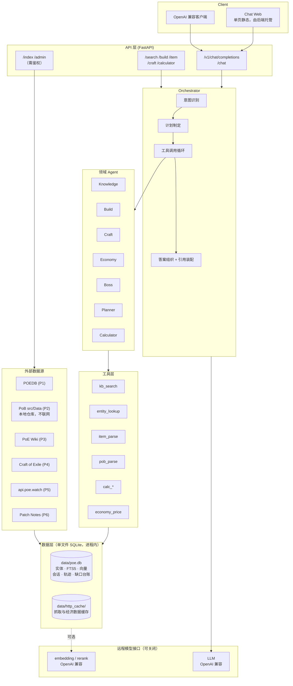
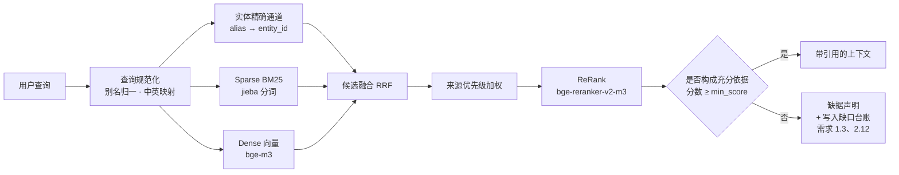
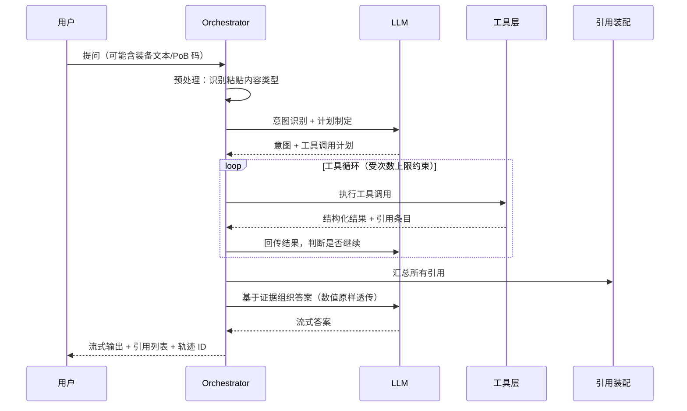

# POE1-Agent 设计文档（Design）

## 1. 设计总纲

系统的可信度来自一条硬性原则：**答案里的每一个事实和每一个数字，都必须能指回一个具体来源或一次具体计算；指不回去的，就不输出。**

POE1 的机制耦合极深，一个错误的小前提会让整条结论反向。因此系统**不提供经验推断**——查不到就明确说查不到，而不是给一个听起来合理的答案。这是产品定位上的取舍：**输出错误内容的代价高于输出「查不到」。**

这条原则决定了四个关键设计取向：

1. **实体优先，而非纯文本切片。** POEDB 的内容本质是结构化的（词缀有数值范围、技能有等级系数、底材有属性）。若直接把网页文本切块喂给向量库，数值会在切片与生成中失真。因此采集阶段先做**结构化实体抽取**，再由实体渲染出用于检索的知识卡片。数值走结构化通道，语义走向量通道。
2. **数值由工具算，不由模型算。** LLM 只负责编排、解释和组织语言；一切数值来自计算器工具或结构化实体库，并原样透传。
3. **来源分级内建于排序，而非写在提示词里。** 来源优先级作为检索排序中的一个显式因子，而不是指望模型「记得」优先采信 POEDB。
4. **禁止推断由代码执行，而非由提示词约束。** 提示词写「不要编造」在概率模型上不是保证。系统在生成后对每条事实断言做**断言—引用绑定校验**，未绑定的断言在出口被拦截并替换为缺据声明。模型能不能忍住不编，不影响最终输出是否合规。

### 1.1 三类内容的分级处理

「禁止推断」若一刀切执行，会连 Build 优化建议、制作路线这类核心功能一起废掉——它们本质上都含判断。因此按内容类型分级：

| 类型 | 判定方式 | 处理 |
| --- | --- | --- |
| **事实断言** | 关于游戏机制/数值/词缀/标签/版本的陈述句 | 必须绑定引用或工具输出；无据即拦截，替换为缺据声明 |
| **计算派生** | 由已引用事实 + 计算器输出组合而成 | 允许，强制附推导链，链上每个输入标注来源。这是可复核演算，不是推断 |
| **建议** | 优化方向、制作路线、投资与规划 | 允许，强制标注为建议 + 写出假设；其事实前提逐条带引用 |

关键区别在于：「你的 Max Hit 是 3200（来源：PoB 解析），Sirus 的落陨伤害是 4100（来源：POEDB），因此会被一击」是**派生**，合法；「Sirus 落陨大概打四千多」是**推断**，拦截。

### 1.2 拒答的粒度是断言，不是整轮

整轮拒答会让「三个子问题里两个有据」的情况变成完全无用。因此拆解为断言级：有据的照答并附引用，无据的逐条列出缺什么、去哪查。同时每条缺据声明写入**缺口台账**，按频次排序后直接成为采集优先级的输入——拒答不是终点，而是知识库补全的驱动信号。

## 2. 总体架构



虚线表示可关闭：向量与重排走远程接口，关闭后系统退化为 BM25 + 实体精确匹配仍可运行。除 LLM 与可选的 embedding 接口外，运行期不依赖任何需要单独启动的进程。

## 3. 技术选型

部署形态：**单进程、单 SQLite 文件、零外部服务**。不使用容器编排。

| 层 | 选型 | 理由 |
| --- | --- | --- |
| 运行时 | Python 3.12（最低 3.10），Windows / macOS / Linux 通用 | 解释器路径不硬编码，由启动层解析 |
| 依赖管理 | `pip` + `venv`，`requirements.txt` + `requirements.lock` | 不引入 uv / poetry / conda |
| 后端框架 | FastAPI + Pydantic v2 + uvicorn（**进程内启动**） | 需求 5.1/6.x 要求 HTTP 与流式；单进程内跑，不额外起服务 |
| LLM 接入 | `openai` SDK 直连内部 LiteLLM 网关 `/v1/chat/completions`，模型 **`glm-5.2`**（见 3.2） | 网关已提供 OpenAI 兼容协议，无需引入第二个 SDK |
| Embedding / ReRank | **同一网关** `/v1/embeddings`、`/v1/rerank`，同一 token（见 3.3） | 省掉第二个供应商与第二套凭证 |
| 全文与 BM25 | **SQLite FTS5 + 内置 `bm25()` 排序** | 零依赖、进程内。已实测：sqlite 3.51.2 编译含 FTS5，`bm25()` 可用 |
| 向量检索 | **`sqlite-vec` 扩展，向量与实体同库** | pip 可装（含 macOS arm64 / linux wheel），无独立服务；装不上时退化为 numpy 暴力检索 |
| 嵌入 / 重排 | 远程 OpenAI 兼容接口调用，**可配置关闭** | 不在本机常驻模型进程；关闭时退化为 BM25 + 实体精确匹配 |
| 中文分词 | `jieba`（纯 Python，无需编译） | 满足需求 3.4，写入 FTS5 前预分词 |
| 存储 | **单文件 SQLite（WAL）**：实体库 + FTS 索引 + 向量 + 会话 + 轨迹 + 缺口台账 | 一个文件承载全部状态，便于备份与迁移 |
| 采集 | `httpx` + `selectolax` + 磁盘缓存 + 令牌桶限速 | 快、轻，易于遵守站点限速 |
| 前端 | **单页静态（HTML + 原生 JS）**，由 FastAPI `StaticFiles` 托管 | 去掉 Node 进程与构建步骤；`marked` + `highlight.js` 由 CDN 或本地静态文件提供 |
| 进程管理 | `scripts/setup.sh` 初始化 + systemd unit（生产）+ `nohup`（开发兜底） | 不引入容器与编排 |
| 配置 | `.env`（pydantic-settings，密钥）+ `config.yaml`（声明式行为） | 密钥与声明式行为分离 |
| 可观测 | 结构化日志（按日期后缀命名，不做 rename 轮转）+ 轨迹落库 | 不引入 APM；避开 Windows 文件占用导致的轮转失败 |

### 3.1 必须监听 HTTP 端口，以及由此而来的加固要求

需求明确要求 Chat Web 与 OpenAI 兼容 API（需求 5.1、6.1–6.10），因此**必须监听 HTTP 端口**。这与「零外部服务」不冲突——监听的是自己的进程，不引入额外中间件。

监听端口就有对外暴露面，所以以下两项不是可选项：

- 普通 API 按 Key 鉴权并限流，避免被当作免费 LLM 代理（需求 5.3、16.7）
- 默认仅绑定 `127.0.0.1`；需要对外提供时由使用者自行加反向代理与 TLS，程序不默认监听 `0.0.0.0`

### 3.2 LLM 接入：HTTP 直连，不用 CLI 子进程模式

接入这类网关有两条常见路线：一是通过 Claude Agent SDK 启动 `claude` CLI 子进程；二是用 `openai` SDK 直连 OpenAI 兼容端点并自跑 ReAct 循环。

**poe-agent 走直连那条，不用 CLI 子进程模式**，三个理由：

1. **拿不到 token 流就没法做出口校验。** 断言—引用绑定校验要求按句缓冲、校验通过才下发（见 11.1）。CLI 子进程模式拿不到可控的增量流。这条闸门是「无据不答」的最后一道，不能妥协。
2. **依赖 Node 运行时，与 Windows 轻量迁移冲突。** `claude` CLI 需要 Node 环境，还得靠额外的环境变量钉死 CLI 的路径与版本。我们刚把 Node 从技术栈里去掉，不应该从后门请回来。
3. **职责重复。** Claude Agent SDK 自带工具集与会话管理，而 poe-agent 需要自己的工具注册、引用装配、数值回填与绑定校验。两套机制叠在一起只会互相干扰。

**注意区分**：不用 `claude` **CLI 子进程**，不等于不能用这个网关。

### 3.2.1 网关实际形态（已实测）

内部网关（实际地址配置在 `.env` 的 `LLM_BASE_URL`，本文档一律以
`https://your-llm-gateway.example.com` 占位）是 **LiteLLM 1.82.3 代理**
（根路径为其 Swagger UI，`/openapi.json` 共 522 个端点）。它同时暴露多套协议，以下端点均已确认存在（无凭证访问返回标准 `401 auth_error`，说明路由存在只是需要鉴权）：

| 端点 | 协议 | 用途 |
| --- | --- | --- |
| `/v1/chat/completions` | OpenAI 兼容 | **poe-agent 用这个** |
| `/v1/messages` | Anthropic 兼容 | poe-agent 不走这条 |
| `/v1/embeddings` | OpenAI 兼容 | 向量通道 |
| `/v1/rerank`、`/v2/rerank` | LiteLLM rerank | 重排通道 |
| `/v1/models`、`/v1/model/info` | — | 查网关上实际可用的模型 |

结论有两个：

1. **不需要 `anthropic` SDK。** 网关已经提供 OpenAI 兼容协议，`openai` SDK 直连即可，少一个依赖。会看到有些接法配 `ANTHROPIC_BASE_URL`，那是因为它们走 `claude` CLI，而 CLI 只会说 Anthropic 协议——那是 CLI 的约束，不是网关的约束。
2. **模型与协议解耦。** 用户示例里 `ANTHROPIC_CUSTOM_MODEL_OPTION: glm-5.2` 说明网关背后可挂非 Claude 模型。poe-agent 指定模型 **`glm-5.2`**。

**用户示例中有三项是 Claude Code CLI 专用的，不要带进 poe-agent 配置**：`ANTHROPIC_CUSTOM_MODEL_OPTION_NAME` 与 `ANTHROPIC_CUSTOM_MODEL_OPTION_DESCRIPTION` 只是 CLI 模型选择器里的显示标签，`ANTHROPIC_CUSTOM_MODEL_OPTION` 也是 CLI 的注册机制。poe-agent 不用 CLI，只需要三个值：`base_url` + `api_key` + `model`。

### 3.2.2 客户端设计

保留 LLM 客户端接口抽象（便于将来换网关或换供应商），但**只实现 OpenAI 兼容一种**——不为假想的可移植性提前写第二套实现。

```
LLM_PROVIDER   = openai
LLM_BASE_URL   = https://your-llm-gateway.example.com
LLM_API_KEY    = <LiteLLM virtual key>
LLM_MODEL      = glm-5.2
```

鉴权走标准 `Authorization: Bearer <key>`（LiteLLM virtual key），不需要 `ANTHROPIC_AUTH_TOKEN` 加 CLI settings 那套绕行——那个绕行是为了解决 CLI 读取凭证的优先级问题，我们直连 HTTP 不存在该问题。

### 3.2.3 实测结论（2026-08-04，脚本 `scripts/probe_gateway.py`，11/13 通过）

架构地基的两项关键能力**均已验证可用**：

| 能力 | 结果 | 实测细节 |
| --- | --- | --- |
| 模型清单 | 通过 | 网关共 19 个模型，`glm-5.2` 在列 |
| 基础 chat | 通过 | 4.3s 返回 |
| **tool calling** | **通过** | 正确调用 `kb_search`，参数为合法 JSON：`{"query": "Headhunter 猎首", "category": "unique_item"}` |
| **多轮 tool calling** | **通过** | 回传工具结果后基于其生成 523 字，并主动提及来源 POEDB |
| **流式 SSE** | **通过** | 正文 13 个增量分片，粒度足够按句缓冲 |
| embeddings | **不可用** | 网关未注册任何 embedding 模型 |
| rerank | **不可用** | 网关未注册任何 rerank 模型 |

结论：**编排器设计不需要改动**，`openai` SDK + tool calling + 流式这条路可用。

### 3.2.4 GLM 5.2 是推理模型——四条必须遵守的约定

实测发现 GLM 5.2 返回 `reasoning_tokens` 与 `reasoning_content`，属推理模型。这带来四个具体约束：

**1. `max_tokens` 必须留足推理预算。** 实测「只回答两个字：收到」这种极简任务，消耗 `completion_tokens=117`，其中 `reasoning_tokens=114`，正文仅 2 字。若 `max_tokens` 设小（首次测试设 64），推理会吃光预算导致**正文为空且不报错**——这是最隐蔽的失败模式。因此配置项 `llm.max_tokens` 的下限要显著高于对正文长度的估计，并在正文为空但 `reasoning_tokens > 0` 时记录明确告警。

**2. Token 计量必须计入 reasoning tokens。** 上例中推理占总输出的 98%。需求 16.4 的成本上限若只统计正文，会严重低估实际消耗。

**3. 推理流与正文流分离，按句校验只处理正文。** 实测流式返回中，`reasoning_content` 有 116 个分片且**全部出现在正文之前**，与 `content` 字段完全分离。因此 11.1 的按句缓冲只消费 `delta.content`，`reasoning_content` 不参与断言绑定校验。

**4. 推理内容绝不可作为答案展示。** 这条是安全要求而非工程偏好：推理过程正是模型动用参数记忆做猜测的地方，而那恰恰是「无据不答」要拦截的东西。若把 `reasoning_content` 透给用户，等于绕过全部六道闸门。前端可以显示「思考中」状态，但不得渲染推理正文。

**首字节延迟的连带影响**：推理 116 个分片全在正文之前，意味着用户需等待完整推理结束才看到第一个字。需求 16.3 的「首字节 5 秒」指标在推理模型下应按**正文首字节**衡量，并通过前端的「思考中」状态提示填补等待期，而不是靠放宽指标掩盖。

**四项已在生产里踩过坑的工程实践**（直接沿用，不重新发明）：

1. **多 Key 故障转移 + 按失败类型分级冷却。** 用一个凭证池：Key 按优先级排列、粘性选择第一个健康的；额度耗尽类冷却 30 分钟（`COOLDOWN_BUDGET`，因为额度是带外补充的，值得定期重试），鉴权/模型权限类冷却 60 分钟（`COOLDOWN_AUTH`，配置错误不会自愈但也别写死到进程结束）；5xx / 429 等瞬时错误**只重试不降级 Key**。配置格式沿用 `key[:model]` 逗号分隔——因为受限 Key 访问别的模型只会返回 401，切 Key 必须同时切模型。
2. **模型别名表。** 用 `opus / sonnet / haiku` 这类短名映射到完整模型 ID，让配置与运行时切换都不必写全名。
3. **分级退避重试。** `[1, 2, 4, 8, 15]` 秒，429 单独识别。
4. **便宜模型做二次守门。** 「回答是否切题」这类二次判断交给廉价模型，成本远低于主模型。poe-agent 的事实句分类（11.1 中判定「这句是不是事实断言」）是同类场景，同样用小模型或规则前置，不占用主模型预算。

**日志安全**：Key 一律脱敏后输出（`mask()`：`前7位…后4位`），完整 Key 不得进日志。

### 3.3 Embedding / ReRank 走同一网关

向量通道没有现成配置可照抄，需要自己定。网关这边是现成的：LiteLLM 的 `/v1/embeddings` 与 `/v1/rerank` 已确认存在，因此 embedding 与 rerank 可以复用**同一 base_url + 同一 token**，不必引入第二个供应商、第二套凭证。

配置上仍保持为独立的三元组（便于将来指向别处），但默认与 LLM 指向同一网关：

```
EMBEDDING_BASE_URL = https://your-llm-gateway.example.com
EMBEDDING_API_KEY  = <同一 virtual key>
EMBEDDING_MODEL    = <取决于网关配置，需查 /v1/models>
RERANK_MODEL       = <同上>
```

**实测结论（2026-08-04）**：`/v1/embeddings` 与 `/v1/rerank` 端点存在，**但网关上未注册任何 embedding 或 rerank 模型**（19 个模型全部是对话模型：Claude 系列、GPT 系列、DeepSeek、GLM）。

因此 **V1 确定关闭向量通道**：

```yaml
retrieval:
  vector: { enabled: false }   # 网关无 embedding 模型
  rerank: { enabled: false }   # 网关无 rerank 模型
```

检索退化为 **BM25（FTS5）+ 实体精确匹配 + `search_keywords` 补偿**。这条路径的能力边界见 3.4：专名查询不受影响，描述性查询依赖 `search_keywords` 的覆盖质量。

要启用向量通道有两条路，都不阻塞 V1：

1. 请网关运维在 LiteLLM 上注册一个 embedding 模型（如 `bge-m3`、`text-embedding-3-small`）。这是最省事的方式——注册后 poe-agent 只需改配置，代码无需改动。
2. 单独接一个提供 embedding 的供应商，配置项本就独立（`EMBEDDING_BASE_URL` 等），改指向即可。

**维度不预设**：一旦有了 embedding 模型，建索引前先探测其实际输出维度再建 `chunk_vec` 表，不要写死 1024（`bge-m3` 是 1024 维，但网关上未来注册的模型可能不同）。

**顺带的运维发现**：探测时 `~/.claude/settings.json` 里的 token 已于 2026-07-31 15:59 UTC 过期，换用备用 Key 列表里的第二个才可用。这实证了多 Key 故障转移设计的价值——也是 poe-agent 沿用该设计的直接理由（见 3.2）。

### 3.4 去掉三个独立服务后的连带影响

原方案的 Docker Compose 存在的唯一理由是三个独立服务：Qdrant、本地 embedding/rerank 推理服务、Next.js 前端。逐个消掉后：

| 原服务 | 替代 | 代价 |
| --- | --- | --- |
| Qdrant | SQLite FTS5（BM25）+ sqlite-vec（向量） | 失去服务端混合检索与分布式扩展；融合与重排改在应用层做。以 POEDB 的数据量级（实体万级、chunk 十万级内）单机足够 |
| 本地 bge-m3 / reranker 服务 | 远程 OpenAI 兼容 embedding / rerank 接口，可关闭 | 建索引时需为全库 chunk 调远程接口，有费用与耗时；无网络或不愿付费时须接受降级 |
| Next.js 前端 | 单页静态 + 后端托管 | 失去组件生态与 SSR，前端交互需手写。但需求 6 的功能（Markdown、流式、粘贴识别、引用展示）用原生 JS 均可实现 |

**向量检索关闭后的补偿**（需求 3.12）：POE1 的查询主体是专名（装备名、技能名、Boss 名），BM25 + 别名表命中率高；真正依赖语义的是描述性查询（如「怪物死亡后偷取词缀的头盔」）。补偿办法是在实体渲染阶段额外生成 `search_keywords` 字段（对猎首即「偷取 词缀 怪物 死亡 稀有」等），一并写入 FTS5。这把一部分语义检索需求转化成了关键词检索，代价是需要维护关键词生成规则。

**对「无据不答」的影响是正面的**：BM25 与精确匹配的命中是确定性的，比向量余弦相似度更容易设定可解释的阈值——没命中就是真没命中，不存在「相似度 0.72 算不算有据」的模糊地带。

## 4. 目录结构

仓库根平铺，不做 `src/` 包布局、不打包安装，以仓库根为工作目录直接运行（配置里的路径均相对工作目录）。

```
poe-agent/
├── main.py                     # 入口：装配 FastAPI + 启动 uvicorn + setproctitle("poe-agent")
├── config.yaml                 # 声明式行为：来源优先级、检索参数、领域词表、限速
├── .env.example                # 密钥模板（LLM / embedding / 管理令牌）
├── requirements.txt            # 依赖范围
├── requirements.lock           # 钉版本，setup.sh 优先使用
├── core/                       # 基础设施
│   ├── config.py               # pydantic-settings 读 .env + yaml 读 config.yaml
│   ├── db.py                   # 单连接 SQLite（WAL）+ 建表 + FTS5/sqlite-vec 初始化
│   ├── llm.py                  # OpenAI 兼容客户端、Token 计量
│   ├── embedding.py            # 远程 embedding / rerank 客户端（可关闭）
│   ├── logging.py              # 结构化日志 + 轮转
│   └── trace.py                # 执行轨迹落库
├── api/                        # 路由层：仅校验与编排调用
│   ├── chat.py                 # /chat + /v1/chat/completions（流式）
│   ├── search.py  item.py  build.py  craft.py  calculator.py
│   └── admin.py                # /index /admin（独立管理令牌）
├── orchestrator/
│   ├── loop.py                 # 意图→计划→工具循环→答案组织
│   ├── intent.py
│   ├── citation.py             # 引用收集与装配
│   └── binding.py              # 断言—引用绑定校验（出口闸门）
├── agents/                     # 领域 Agent：提示词 + 允许工具集 + 输出契约
├── tools/
│   ├── registry.py             # 工具注册与 JSON Schema 导出
│   └── impl/
├── retrieval/
│   ├── hybrid.py               # RRF 融合 + 优先级加权 + 可选重排
│   ├── fts.py                  # SQLite FTS5 + jieba 分词 + bm25()
│   ├── vector.py               # sqlite-vec；不可用时退化 numpy 暴力检索
│   ├── alias.py                # 别名精确匹配通道
│   └── chunking.py
├── kb/
│   ├── pipeline.py             # 采集→抽取→卡片→索引
│   ├── sources/                # poedb/ wiki/ coe/ patchnotes/
│   ├── extract/                # HTML → 结构化实体（含结构断言）
│   └── render/                 # 实体 → 知识卡片 + search_keywords
├── entities/                   # 实体模型、仓储、taxonomy
├── parsers/
│   ├── item_text.py            # Ctrl+C 装备文本
│   ├── pob.py                  # PoB 码 → zlib → XML → 模型
│   └── passive_tree.py
├── calc/                       # 纯函数计算器 + constants.py（常量附来源与版本）
├── economy/                    # EconomySource 适配层 + 缓存
├── static/                     # 单页前端：index.html + app.js + style.css
├── scripts/
│   ├── setup.sh                # 建 venv、装依赖、建目录、拷配置模板
│   ├── poe-agent.service       # systemd unit（生产）
│   └── eval.py                 # 黄金问答集评测
├── tests/
│   ├── unit/                   # 计算器、解析器、绑定校验
│   └── fixtures/               # 真实装备文本、PoB 码样本
├── data/                       # SQLite 文件 + 抓取缓存（.gitignore）
├── logs/                       # 应用日志与轨迹（.gitignore）
└── .kiro/
```

没有 `docker-compose.yml`、没有 `Dockerfile`、没有 `frontend/` 工程、没有 `pyproject.toml`。

## 5. 知识库设计

### 5.1 双层知识模型

这是整个系统最关键的结构决策。

**Tier A — 结构化实体库（精确层，存 SQL）**

每个游戏对象是一条带类型的记录，字段是机器可用的：

```python
class Entity(BaseModel):
    entity_id: str          # "unique_item:headhunter"，全局稳定主键
    entity_type: EntityType # skill|support|unique|base|mod|boss|map|currency|ascendancy...
    name_zh: str
    name_en: str
    aliases: list[str]      # 社区俗称："猎首", "HH", "Headhunter"
    attributes: dict        # 类型化属性（数值范围、等级、需求、标签…）
    source: SourceRef       # 来源站点 + URL + 抓取时间
    league: str             # "Allflame"
    version: str            # "3.27"
    raw_html_hash: str      # 增量更新判断依据
```

**Tier B — 知识卡片（语义层，存同一 SQLite：FTS5 索引 + sqlite-vec 向量）**

由 Tier A 渲染为规范化 Markdown，再切片索引。卡片包含 `entity_id` 回指，因此检索命中后可无损取回精确数值。

```python
class Chunk(BaseModel):
    chunk_id: str
    entity_id: str | None   # 回指 Tier A
    text: str
    metadata: DocumentMetadata
```

```python
class DocumentMetadata(BaseModel):
    title: str
    category: str           # 需求 2.6 的一级分类
    source: str             # "POEDB" | "PoE Wiki" | ...
    source_priority: int    # 1..7，参与排序；P7 不得支撑事实断言（需求 2.2）
    url: str                # 缺失则不入可引用索引（需求 2.5）
    league: str
    version: str
    language: str = "zh-CN"
    tags: list[str]
    fetched_at: datetime
```

**为什么分两层**：纯 RAG 在「T1 生命词缀是多少到多少」这类问题上不可靠——数字可能落在切片边界外，或被生成过程改写。分层后，检索负责*找到是哪条词缀*，结构化库负责*给出准确数值*。

### 5.2 采集与更新管线

```
robots 校验 → 限速抓取 → 磁盘缓存 → 内容哈希比对
  → （变化）结构化抽取 → 实体入库 → 渲染卡片 → 切片 → jieba 分词写 FTS5 →（可选）嵌入写 sqlite-vec
  → （未变）跳过（需求 2.9）
```

- 限速与并发通过令牌桶集中控制，配置项 `crawl.rps` / `crawl.concurrency`。
- 每个来源实现统一 `Source` 接口：`discover() -> urls`、`fetch(url) -> Response`、`extract(html) -> list[Entity]`。新增数据源只需实现该接口。
- 采集任务写入 `ingest_run` 表（来源、条目数、成败、耗时），供 `/admin` 查询（需求 2.11）。
- **合规**：仅抓取公开页面、遵守 robots.txt、限速、缓存复用、标注来源并链回原站；原始 HTML 落 `data/`（已 gitignore），不入版本库（需求 16.8）。

### 5.3 分类体系

一级分类固定为需求 2.6 的六类，二级分类对应用户 spec 的细分（技能/辅助/天赋/升华/万神殿；唯一/稀有/白装/底材/各类词缀/附魔/品质；精华/化石/收获/辛迪加/野兽/神庙/工艺台；Atlas/地图/Boss/Atlas 天赋；各联盟机制；通货/圣甲虫/命运卡/碎片/地图器）。分类值集中在 `entities/taxonomy.py` 常量表，避免字符串散落。

## 6. 检索管线



设计要点：

1. **实体精确通道**（需求 3.5）：维护 `alias → entity_id` 映射表，覆盖中文名、英文名、社区缩写。命中即把该实体的规范卡片强制注入候选集，解决「猎首」这类专名被语义检索稀释的问题。此通道是纯 SQL 查表，最快且最确定，因此放在最前。
2. **融合用 RRF**：BM25 与向量分数量纲不可比（FTS5 的 `bm25()` 返回负值，向量返回距离），RRF 只用排名不用分值，无需调分数权重，也免去两种量纲的归一化。
3. **来源优先级参与排序**（需求 2.3）：融合后按 `source_priority` 施加衰减因子，使 POEDB 在同等相关度下排前。这是把需求 15.5 落在算法里而不是提示词里。P7 社区来源在此层被标记为不可支撑事实断言（需求 2.2），后续出口校验拒绝以其绑定事实句。
4. **充分依据判定**（需求 1.3）：重排后最高分低于 `retrieval.min_score` 即判定该事实点无充分依据，走缺据声明路径，**不进入生成**。此判定由代码执行，不交给模型自觉。阈值需按黄金问答集调优——过高导致错误拒答，过低导致推断漏出，两者成对监控（需求 16.7）。
5. **超时降级取保守侧**（需求 3.8、3.10）：三路检索并发，任一路超时用已完成结果继续；但此时判定标准收紧，宁可缺据声明也不基于不完整候选集作答。
6. **过滤**：`category` / `league` / `version` 作为 SQL `WHERE` 条件与 FTS5 查询的联合过滤（需求 3.6）。因为实体、FTS 索引、向量在同一个 SQLite 文件里，过滤与检索可以一条 SQL 完成，不需要跨服务的二次筛选。
7. **通道可关闭与降级**（需求 3.11）：`config.yaml` 中 `retrieval.vector.enabled` 与 `retrieval.rerank.enabled` 可独立关闭；远程接口不可用时自动降级为 BM25 + 实体精确，并在检索元数据里标注当前生效通道，使回答可以说明检索能力处于降级状态。

### 6.1 SQLite 侧的具体实现

```sql
-- 实体（精确层）
CREATE TABLE entity (
  entity_id TEXT PRIMARY KEY, entity_type TEXT, name_zh TEXT, name_en TEXT,
  attributes JSON, source TEXT, url TEXT, source_priority INTEGER,
  league TEXT, version TEXT, raw_html_hash TEXT
);
CREATE TABLE alias (alias TEXT, entity_id TEXT, PRIMARY KEY (alias, entity_id));

-- 知识卡片切片 + FTS5（BM25 通道）
CREATE TABLE chunk (chunk_id TEXT PRIMARY KEY, entity_id TEXT, text TEXT, metadata JSON);
CREATE VIRTUAL TABLE chunk_fts USING fts5(
  tokens,            -- jieba 预分词后的文本
  keywords,          -- search_keywords，补偿语义检索
  chunk_id UNINDEXED,
  tokenize = 'unicode61'
);

-- 向量通道（sqlite-vec，与上表同库）
-- 维度不写死：建表前先探测 embedding 模型的实际输出维度
CREATE VIRTUAL TABLE chunk_vec USING vec0(chunk_id TEXT PRIMARY KEY, embedding FLOAT[{dim}]);
```

BM25 检索即 `SELECT chunk_id, bm25(chunk_fts) AS score FROM chunk_fts WHERE chunk_fts MATCH ? ORDER BY score`（`bm25()` 返回值越小越相关，已实测可用）。

**中文分词的落点**：不依赖 SQLite 的分词器处理中文，而是在**写入前**用 jieba 把文本切成空格分隔的词序列存进 `tokens` 列，查询时同样先对查询串分词。这样 `unicode61` 分词器按空格切分即可正确工作，满足需求 3.4 且不需要编译自定义分词扩展。

**sqlite-vec 不可用时的兜底**：以 POEDB 的量级估算，chunk 十万级、1024 维 float32 约 400MB，超出舒适范围；因此兜底路径按 int8 量化后用 numpy 暴力检索（约 100MB），或直接关闭向量通道走 BM25。这个兜底只在扩展装不上时启用，不作为默认路径。

## 7. Orchestrator 与 Agent

### 7.1 单轮执行流程



### 7.2 Agent 划分

Agent 不是独立进程，而是「**提示词 + 允许工具集 + 输出契约**」的组合，由 Orchestrator 按意图路由。V1 只启用 Knowledge Agent，其余按 V2/V3 逐步接入，接口先行预留。

| Agent | 允许工具 | 输出契约 |
| --- | --- | --- |
| Knowledge | `kb_search`, `entity_lookup` | 带引用的解释 |
| Build | `pob_parse`, `calc_*`, `kb_search` | 结构化体检报告（需求 8.4 全项） |
| Craft | `kb_search`, `economy_price`, `calc_*` | 步骤 + 概率 + 成本 |
| Economy | `economy_price` | 价格 + 时间戳 + 来源 |
| Boss | `kb_search`, `entity_lookup` | 机制 + 防御门槛 + 流程 |
| Planner | `kb_search`, `economy_price` | 分阶段路线 + 完成标志 |
| Calculator | `calc_*` | 数值 + 公式 + 过程 |

### 7.3 工具契约

工具以 JSON Schema 注册，统一返回包封：

```python
class ToolResult(BaseModel):
    ok: bool
    data: dict | None
    citations: list[Citation]     # 工具自带引用，供装配层收集
    error: ToolError | None
    elapsed_ms: int
```

- 工具失败不中断整轮（需求 4.4）：Orchestrator 记录降级项，并要求最终答案显式说明哪部分能力不可用。
- 数值防改写（需求 4.6）：工具返回的关键数值以占位符注入提示词，组织答案后由代码回填校验；若模型输出的数值与工具结果不一致，则以工具结果为准并记录告警。
- 上限保护（需求 4.7）：`max_tool_calls`、`max_tokens_per_turn` 双闸门。

### 7.4 执行轨迹

每轮写一条 `trace` 记录（会话 ID、意图、计划、每次工具调用入参出参、检索命中 chunk、耗时、Token 数），满足需求 4.5 与 16.9，同时作为评测与排障的数据基础。

## 8. 解析器设计

### 8.1 装备文本解析（`item_text.py`）

游戏 Ctrl+C 文本以 `--------` 分段，段落语义依位置与关键字判定。解析为：

```python
class ParsedItem(BaseModel):
    item_class: str; rarity: Rarity; name: str | None; base_type: str
    item_level: int | None; quality: int | None
    sockets: SocketLayout | None
    requirements: dict
    implicits: list[ParsedMod]; explicits: list[ParsedMod]
    enchants: list[ParsedMod]; crafted: list[ParsedMod]
    flags: ItemFlags   # corrupted / fractured / synthesised / mirrored / influence[]
```

- 词缀 T 级与数值范围（需求 7.3）不靠正则猜，而是把词缀文本与 Tier A 的 `mod` 实体做匹配：按底材 + 词缀组查出该词缀在此底材上的全部 tier 定义，再定位实际数值落在哪一档。
- 解析失败必须显式失败（需求 7.6）：返回失败原因 + 期望格式样例，禁止部分猜测后继续分析。
- 词缀文本→实体匹配用「数字占位归一化」：把 `+45 to maximum Life` 归一为 `+# to maximum Life` 再查表，兼容中英双语文本。

### 8.2 PoB 解析（`pob.py`）

PoB 分享码为 **URL-safe Base64 编码的 zlib 压缩 XML**：

```
code → base64.urlsafe_b64decode → zlib.decompress → XML → 结构化模型
```

- 同时支持托管链接（如 pobb.in），先取回原始码再走同一路径。
- 提取需求 8.2 全部字段；PoB 自身已算好的 DPS / eHP 等汇总值直接读取，不重算（对应非目标 3）。
- 缺失项标 `unknown` 而非填估计值（需求 8.8）。
- 记录 PoB 版本，与系统数据版本不一致时输出偏差提示（需求 8.9）。
- **数据来源**：`PathOfBuildingCommunity/PathOfBuilding` 的 `src/Data/`（Gems.lua、Bases/、Essence.lua、Bosses.lua、ClusterJewels.lua、Costs.lua 等）作为技能/底材/精华/Boss 的结构化补充源，该仓库活跃维护。**不使用 RePoE**——已于 2024-12 停更，数据会落后当前版本。

### 8.3 Build 报告契约

报告模型强制包含需求 8.4 的全部字段，每个字段为 `CheckItem{value, status, note, citations}`。**字段缺失即为契约违约**，由 Pydantic 校验保证「不得遗漏」是结构性约束而非提示词祈求。

## 9. 计算器设计（`calc/`）

- 每个计算器为纯函数：`(inputs) -> CalcResult{value, formula, steps, assumptions}`，天然可单测（需求 12.2、12.3）。
- 游戏常量集中在 `calc/constants.py`，每个常量标注来源 URL 与适用版本（需求 12.5）。
- 输入校验用 Pydantic 约束，越界返回合法范围（需求 12.4）。
- 覆盖：抗性、吸纳、偷取、暴击、保留、Max Hit、DOT、感电。
- LLM 不得心算（需求 12.6）：涉及数值的意图强制路由到 Calculator 工具。

## 10. 经济数据设计（`economy/`）

**实测前提**：poe.ninja 旧公开 API（`/api/data/currencyoverview`、`itemoverview` 等）已全部返回 404，站点迁移到 `/poe1/economy/*` 前端路由且页面内无可用 API 线索。因此设计为适配层而非单点依赖：

```python
class EconomySource(Protocol):
    name: str
    async def prices(self, league: str, category: PriceCategory) -> PriceSnapshot: ...
    async def health(self) -> bool: ...
```

| 顺位 | 源 | 状态 |
| --- | --- | --- |
| 主源 | `api.poe.watch` | 实测 200，返回 JSON，含当前赛季 Allflame |
| 备源 | GGG 官方 Trade API | 需 OAuth 与严格限速，作为兜底 |
| 参考 | poe.ninja 网站 | 仅作人工参考链接，不做程序依赖 |

- 每个 `PriceSnapshot` 携带 `source`、`league`、`fetched_at`；超过 `economy.stale_after` 即在回答中给出陈旧警告（需求 10.6）。
- 主源不可用时自动降级并在回答中说明实际使用来源（需求 10.4）。
- 缓存 + 限速遵守上游约束（需求 10.5）。
- 赛季名不硬编码，启动时从 GGG `api/leagues` 解析当前挑战赛季（当前为 `Allflame`）。

## 11. 引用与诚实性机制

需求 15 是产品的信任基础。它落地为**六道代码级闸门**，而非写在系统提示词里——提示词对概率模型不构成保证：

| # | 闸门 | 位置 | 作用 |
| --- | --- | --- | --- |
| 1 | 无 URL 不入索引 | 采集管线 | 任何可被检索到的内容都可溯源（需求 2.5） |
| 2 | 抽取失败即排除 | 采集管线 | 结构断言不通过的条目不得以部分字段入库（需求 2.7） |
| 3 | 优先级加权排序 | 检索融合层 | POEDB 结构性优先（需求 15.5） |
| 4 | 充分依据判定 | 检索后置 | 无充分依据的事实点不进入生成（需求 1.3） |
| 5 | **断言—引用绑定校验** | 生成出口 | 未绑定引用的事实断言被拦截（需求 15.4） |
| 6 | 数值回填校验 | 答案组织层 | 工具数值不被模型改写（需求 4.6） |

### 11.1 断言—引用绑定校验（Claim-Citation Binding）

这是「禁止推断」的最后一道也是最关键的一道闸门。前面几道保证*进入*生成的证据是干净的，这一道保证*离开*生成的内容没有夹带模型自己编的东西。

**机制**：

1. **证据编号**：进入生成的每条证据分配 `E1`、`E2`… 编号，连同其引用一起注入上下文。
2. **强制标注**：提示词要求模型在每个事实句末尾附 `[[E<n>]]` 标记，声明该句依据哪条证据。
3. **出口校验**：生成后由代码逐句扫描：
   - 判定句子是否为事实断言（句式 + 领域词表 + 是否含数值/机制术语）
   - 若是事实断言但无 `[[E<n>]]` 标记 → **拦截**
   - 若有标记但编号不存在或该证据内容不支撑此句（关键实体/数值不匹配）→ **拦截**
4. **拦截后处理**：不是删掉了事，也不是让模型改写成模糊表述（那等于把推断藏进模糊语言）。被拦截的断言替换为该点的缺据声明，并记入缺口台账与轨迹。
5. **告警**：拦截事件计入 `leakage_blocked` 指标。频繁拦截说明提示词或检索有问题，需要调查而不是静默容忍。

```python
class Claim(BaseModel):
    text: str
    kind: ClaimKind            # factual | derivation | recommendation
    evidence_ids: list[str]    # 绑定的 E 编号
    bound: bool                # 校验结果
    block_reason: str | None
```

**为什么不只靠提示词**：模型在长上下文、多工具结果的情况下漏标或错标是常态，且它无法可靠自评「这句我是查到的还是记得的」。把判定移到代码侧，合规性就与模型的自律程度解耦了。

**与流式输出的冲突**：出口校验要求「先验证后输出」，而流式要求「边生成边推送」——已经推送给用户的句子无法撤回。解决方式是**按句缓冲**：以句子边界为单位累积，校验通过才下发该句。代价是首字节延迟从 token 级退化到句级，这个代价是必要的——把未校验内容先推给用户，等于闸门失效。首字节延迟指标（需求 16.3）按此口径衡量。

**只消费正文流**：GLM 5.2 为推理模型，流式返回中 `delta.reasoning_content` 与 `delta.content` 分离且推理分片全在正文之前（见 3.2.4）。按句缓冲**只处理 `delta.content`**；`reasoning_content` 不参与绑定校验，也**不得渲染给用户**——推理过程正是模型动用参数记忆猜测的地方，透出去等于绕过全部闸门。

**已知代价**：句子级事实判定会有误判。误判为事实断言（过严）导致合法的建议句被拦，误判为非事实（过松）导致推断漏出。因此该分类器的行为必须纳入黄金问答集评测，与错误拒答率一并监控（需求 16.7），并支持在配置中调整领域词表。

引用模型：

```python
class Citation(BaseModel):
    source: str          # "POEDB"
    title: str           # "猎首（Headhunter）"
    url: str
    entity_id: str | None
    priority: int
    fetched_at: datetime
```

渲染格式：`来源：POEDB → 猎首（Headhunter）` + 可点击 URL（需求 15.6）。

冲突处理：当同一 `entity_id` 在不同来源存在数值差异时，装配层生成对照块（POEDB 描述 / Wiki 描述 / 推荐采用 POEDB），而不是让模型自行取舍。

## 12. API 设计

| 端点 | 方法 | 说明 | 鉴权 |
| --- | --- | --- | --- |
| `/v1/chat/completions` | POST | OpenAI 兼容，支持 `stream` | API Key |
| `/chat` | POST | 原生接口，返回引用与轨迹 ID | API Key |
| `/search` | POST | 纯检索，供质量评测（需求 3.7） | API Key |
| `/item` | POST | 装备文本解析与分析 | API Key |
| `/build` | POST | PoB / 天赋树 / 角色导入分析 | API Key |
| `/craft` | POST | 制作规划 | API Key |
| `/calculator/{name}` | POST | 各计算器 | API Key |
| `/index/*` | POST | 触发采集、重建索引 | **管理凭证** |
| `/admin/*` | GET/POST | 采集任务、轨迹、配置查询 | **管理凭证** |
| `/healthz` | GET | 向量库/DB/LLM 通道状态 | 公开 |

> ⚠️ **安全提示**：`/index` 与 `/admin` 能触发外部抓取与索引重建，属于可被滥用的高开销操作。这两组端点必须在 V1 首个可运行版本就带鉴权，不能留到后期补——默认实现为独立管理令牌 + 可选 IP 白名单，且不与普通用户 API Key 共用凭证。流式接口同样需要按 Key 限流，避免被用作免费 LLM 代理。

## 13. 前端设计

前端为**单页静态资源**（`static/index.html` + `app.js` + `style.css`），由 FastAPI 的 `StaticFiles` 直接托管，无构建步骤、无 Node 运行时、无独立端口。Markdown 用 `marked`，代码高亮用 `highlight.js`，两者以本地静态文件形式随仓库提供（不依赖 CDN，便于内网部署）。

选择原生 JS 而非 Next.js 的代价是要手写交互逻辑，但需求 6 的全部功能——Markdown 渲染、流式追加、粘贴分流、引用角标、缺据声明样式、会话列表——都不需要框架级能力，且省掉了一个常驻 Node 进程和一整套构建链。

- **流式**：`fetch` + `ReadableStream` 消费 SSE，逐句追加渲染（后端按句下发，见 11.1）（需求 6.2）。
- **粘贴识别**（需求 6.3、6.4）：`onPaste` 拦截，按特征分流——含 `--------` 分隔与 `Item Class` / `物品类别` 判为装备文本；Base64 长串或 pobb.in 链接判为 PoB；其余按普通文本处理。识别结果以可视卡片形式先呈现给用户确认，避免误判直接进入分析。
- **引用展示**（需求 6.6）：答案内联角标 + 底部来源列表，均可点击跳转。
- **缺据声明展示**（需求 6.8）：后端返回 `evidence_gap` 段时，前端以明确可辨的样式呈现「知识库查不到 + 缺失的具体信息点 + 建议查证途径（可点击链接）」，不与普通答案文本混排。
- **事实与建议分区**（需求 6.9）：`kind=recommendation` 的内容与事实性内容视觉分区，避免用户把建议当成机制事实。
- **会话历史**（需求 6.7）：服务端持久化，前端支持切换与重命名。
- **响应式**（需求 6.10）：CSS 媒体查询适配移动端。

## 13.1 部署与运维

venv + pip + 单进程，生产用 systemd 托管。

**首次安装**（`setup.py` 是跨平台真源，`.sh` / `.bat` 只是薄封装）

```bash
# macOS / Linux
python3 scripts/setup.py       # 建 .venv、装 requirements.lock、建 data/ logs/、拷配置模板
cp .env.example .env           # 填 LLM API Key、embedding 接口、管理令牌
```

```bat
:: Windows
python scripts\setup.py
copy .env.example .env
```

随后按需编辑 `config.yaml`（检索参数、来源优先级、是否启用向量与重排、监听地址）。

**启动**

```bash
# macOS / Linux
.venv/bin/python main.py                                  # 前台
nohup .venv/bin/python main.py > /dev/null 2>&1 &         # 后台（开发兜底）
```

```bat
:: Windows
.venv\Scripts\python main.py                              :: 前台
start "" .venv\Scripts\pythonw.exe main.py                :: 后台
```

**停止**：前台 `Ctrl+C`；后台由各平台自己的方式处理（Linux `systemctl stop`、Windows 任务管理器或 `taskkill`、macOS `kill`）。应用不自带跨平台的 stop 命令——因为**单实例保护靠端口绑定**，不需要 PID 文件管理。

**建索引**（首次或版本更新后，可通过带鉴权的管理接口触发，也可直接跑模块）

```bash
.venv/bin/python -m kb.pipeline --source poedb --category unique_item    # Windows 换 .venv\Scripts\python
```

**生产**：Linux 用 `scripts/poe-agent.service`（`Type=simple` + `Restart=always` + `RestartSec=5` + `PYTHONUNBUFFERED=1` + `PYTHONUTF8=1` + `NoNewPrivileges=true`）；Windows 用计划任务或 NSSM 注册服务。日志按日期后缀直接落 `logs/`，不做 rename 轮转（避开 Windows 文件占用问题），不依赖 logrotate。

**运行时产物**（全部 gitignore）：`data/poe.db`（唯一状态文件）、`data/http_cache/`（抓取缓存）、`logs/`、`.venv/`。

**优雅关停**：收到 SIGTERM/SIGINT（Windows 上还包括 `KeyboardInterrupt` 与 uvicorn lifespan 关停）后停止接受新请求、等待进行中的请求完成（上限可配置）、`db` 连接 checkpoint 后退出，避免 WAL 残留。注册信号前对平台不存在的信号做存在性判断（`SIGHUP` 在 Windows 上没有）。

**备份**：运行中不直接复制 `data/poe.db`，而由 `core/backup.py` 使用 SQLite Backup API
从活跃 WAL 连接创建一致性单文件快照。伴随清单固定数据库 SHA-256、schema 指纹、关键表
行数、页信息与应用/SQLite 版本，校验时重跑 `PRAGMA quick_check`。恢复只允许离线 CLI：
默认预检，目标存在 WAL/SHM/journal 就拒绝；显式 `--apply` 后先备份当前库，再用同目录临时
文件与原子替换恢复。管理 API 只开放创建/列表/校验，不开放远程恢复。跨平台迁移仍只需
已校验的 `.db` 快照（清单随附）；`data/` 必须位于**本地磁盘**，SQLite WAL 在网络共享盘上
锁不可靠。

## 13.2 跨平台可移植性（Windows / macOS / Linux）

核心原则：**应用代码平台中立，平台差异只存在于启动层与进程托管层。** 迁移到 Windows 不需要改任何业务代码，只换启动方式。

### 13.2.1 依赖的 Windows 可用性（已实测）

| 依赖 | Windows 状态 |
| --- | --- |
| fastapi / uvicorn / pydantic / pydantic-settings / httpx | 纯 Python wheel，全平台通用 |
| jieba | 纯 Python 源码包，无 C 扩展，可直接安装 |
| selectolax | 有 win32 / win_amd64 / **win_arm64** wheel |
| numpy | 有 win32 / win_amd64 / win_arm64 wheel |
| setproctitle | 有 win32 / win_amd64 wheel，但 Windows 上改进程名基本无效 → 降级为 best-effort |
| **sqlite-vec** | **仅 win_amd64，没有 win_arm64** → Windows on ARM 上向量通道不可用，自动降级 |

结论：核心链路（FastAPI + SQLite FTS5 + jieba + httpx + selectolax）在 Windows 上零障碍；唯一有平台限制的是可选的向量通道。

### 13.2.2 SQLite 扩展加载：真实存在的平台差异

FTS5 是**编译进 SQLite 的**，不需要扩展加载，因此 BM25 通道在所有平台都可用。但 sqlite-vec 是**可加载扩展**，依赖 `Connection.enable_load_extension`，而这个方法在部分 Python 发行版里被编译关闭。本机实测：

| Python | `enable_load_extension` | FTS5 | 结论 |
| --- | --- | --- | --- |
| Homebrew Python 3.12.13 | 可用 | 可用 | 向量通道可用 |
| macOS 系统自带 Python 3.9.6 | **不存在**（编译带 `OMIT_LOAD_EXTENSION`） | 可用 | 向量通道不可用，BM25 正常 |

这不是 Windows 独有问题，而是**发行版差异**。因此：

- 启动时探测三件事：`hasattr(conn, "enable_load_extension")` → 能否实际启用 → 能否加载 sqlite-vec。任一失败即禁用向量通道并记录原因，**不让启动失败**（需求 16.13）。
- 文档明确要求使用 python.org 官方发行版或 Homebrew Python，**不要用系统自带 Python**（macOS 自带的 3.9 就是反例）。
- 这也再次说明为什么 BM25 必须是主通道而非补充：它是唯一在所有平台、所有发行版上都确定可用的检索能力。

### 13.2.3 逐项平台差异与对策

| 差异点 | Windows 上的问题 | 对策 |
| --- | --- | --- |
| **文本编码** | 默认 cp936/GBK，中文写入日志与文件会乱码或抛 `UnicodeEncodeError` | 所有 `open()` 与日志 handler 显式 `encoding="utf-8"`；启动器设 `PYTHONUTF8=1`；`sys.stdout.reconfigure(encoding="utf-8")` |
| **日志轮转** | `TimedRotatingFileHandler` 靠 rename 轮转，文件被杀软/索引器占用时抛 `WinError 32` | 改为**按日期后缀直接命名**新文件（`app-2026-08-04.log`），不做 rename，从根本上避开文件占用 |
| **信号** | 无 `SIGHUP`，`SIGTERM` 语义也不同 | 注册前用 `hasattr(signal, "SIGHUP")` 判断；关停逻辑不依赖特定信号，同时支持 `KeyboardInterrupt` 与 uvicorn 自身的 lifespan 关停 |
| **进程识别与单实例** | 无 `ps -ef`，`setproctitle` 无效 | **单实例保护靠 HTTP 端口绑定失败**——跨平台且天然可靠，不用 PID 文件也不用 `kill`。查进程改由各平台自己的工具（任务管理器 / `tasklist`） |
| **路径** | 分隔符 `\`，盘符，大小写不敏感 | 一律 `pathlib.Path`，禁止字符串拼路径与硬编码 `/` |
| **长路径** | `MAX_PATH` 260 限制，抓取缓存若以 URL 命名极易超长 | HTTP 缓存文件名用 URL 的哈希值，不用 URL 原文 |
| **文件权限** | 无 POSIX 权限位，`chmod 600` 语义不同 | `os.chmod` 尝试执行并容忍失败；Windows 上依赖目录 ACL，文档提示把仓库放在用户目录下 |
| **换行符** | Git 自动转 CRLF 会破坏 `.sh` 脚本 | `.gitattributes`：`* text=auto`，`*.sh text eol=lf` |
| **WAL 与网络盘** | SQLite WAL 在 SMB/网络共享上锁不可靠 | 明确要求 `data/` 位于本地磁盘 |
| **Unix 工具依赖** | 无 `ps`/`grep`/`awk`/`nohup` | 应用代码禁止 shell 调用这些工具；采集、索引等操作全部走 Python 实现或 HTTP 接口 |

### 13.2.4 引导与托管：Python 是唯一真源

```
scripts/setup.py        # 唯一真源，跨平台：建 venv、装依赖、建目录、拷配置模板
scripts/setup.sh        # 薄封装：exec python3 scripts/setup.py "$@"
scripts/setup.bat       # 薄封装：python scripts\setup.py %*
```

`setup.py` 用 `sys.executable` 与 `venv` 模块建环境，用 `pathlib` 处理路径，不调用任何 shell 工具，因此三平台行为一致。

启动方式按平台提供，但都只是启动同一个 `main.py`：

| 平台 | 前台 | 后台 / 常驻 |
| --- | --- | --- |
| Windows | `.venv\Scripts\python main.py` | `start.bat` + `pythonw.exe`，或计划任务（Task Scheduler），或 NSSM 注册为服务 |
| macOS | `.venv/bin/python main.py` | `nohup`，或 launchd plist |
| Linux | `.venv/bin/python main.py` | systemd unit（`scripts/poe-agent.service`） |

这些都是**部署产物，不是代码依赖**。应用本身不知道自己被谁托管。

### 13.2.5 迁移动作清单

从 macOS 迁到 Windows 实际要做的事：

1. 装 python.org 官方 Python 3.12（不要用 Microsoft Store 版，避免路径重定向问题）
2. `python scripts\setup.py`
3. 复制 `.env` 与 `config.yaml`
4. 复制 `data\poe.db`（单文件，含全部知识库与索引，**无需重新采集**）
5. `.venv\Scripts\python main.py`

第 4 步是单文件存储带来的直接好处：知识库迁移就是复制一个文件。若目标机是 Windows on ARM，向量通道会因 sqlite-vec 无 arm64 wheel 自动禁用，退化为 BM25 + 实体精确匹配，功能可用。

## 14. 测试与评测策略

| 层级 | 对象 | 方法 |
| --- | --- | --- |
| 单元测试 | 计算器、装备解析、PoB 解析、词缀 tier 匹配 | pytest + 真实样本 fixture（真实 Ctrl+C 文本与 PoB 码） |
| 契约测试 | Build 报告字段完整性 | Pydantic 模型校验，缺项即失败（需求 8.4） |
| 检索评测 | 黄金问答集 | 命中率 Recall@k、引用正确率、来源优先级正确性（需求 16.7） |
| 集成测试 | API 端到端 | LLM 与外部源以录制响应打桩，保证可离线跑 |

外部数据源在测试中一律打桩，避免测试依赖网络与上游可用性。

## 15. 风险与对策

| 风险 | 影响 | 对策 |
| --- | --- | --- |
| **上游站点结构变更**导致抽取失效 | 知识库停止更新或产生脏数据 | 抽取器带结构断言，字段缺失即让该次采集失败而非静默写入；抽取器按来源隔离 |
| **poe.ninja API 已下线**（已发生） | 经济能力无数据 | 适配层 + poe.watch 主源 + 官方 Trade API 兜底，来源在回答中透明标注 |
| **RePoE 停更** | 结构化数据落后版本 | 改用活跃的 PoB 仓库数据 + `dat-schema` 提取路径 |
| 版本更新致知识过期 | 回答错误且用户不知情 | 文档强制带 `version`/`league`；跨版本冲突显式对照；陈旧数据给警告 |
| 抓取被限流或封禁 | 采集中断 | 限速 + 缓存 + 增量 + 可识别 UA + 遵守 robots |
| LLM 幻觉数值或编造机制 | 破坏信任，且 POE 机制耦合深，小错致整条结论反向 | 六道闸门，重点是断言绑定校验（出口拦截）+ 数值回填 + 计算器强制路由 |
| **禁止推断导致过度拒答** | 系统显得无用，用户流失 | 断言级而非整轮拒答；缺据声明给出查证途径；缺口台账驱动补库；错误拒答率纳入评测并与漏出率成对调优 |
| 事实句分类器误判 | 过严拦合法建议，过松放推断 | 领域词表可配置；分类行为纳入黄金问答集；拦截事件全部留痕可复查 |
| 成本失控 | 费用不可预期 | 单轮工具调用与 Token 双上限 + 轨迹记录消耗 |
| 管理端暴露 | 被滥用触发抓取/索引重建 | 独立管理凭证、限流、默认只绑 127.0.0.1、可选 IP 白名单 |
| **单进程单文件的容量上限** | 数据量或并发增长后 SQLite 写入与检索成为瓶颈 | 明确适用范围：单机、个人到小团队规模。写入集中在采集阶段（可离线跑），查询以读为主，WAL 下读不阻塞。触及上限的信号是检索耗时超标，届时再迁 Postgres + 独立向量库，检索层已按接口隔离 |
| **sqlite-vec 装不上或扩展加载被禁用** | 向量通道不可用。已实测两种触发场景：Windows on ARM 无 arm64 wheel；部分 Python 发行版编译带 `OMIT_LOAD_EXTENSION`（macOS 自带 3.9 即是） | 启动时三级探测并自动禁用该通道且不影响启动；兜底 int8 量化 + numpy 暴力检索；或走 BM25 + 实体精确 + `search_keywords` 补偿。文档要求使用 python.org / Homebrew 发行版 |
| **平台默认编码导致中文损坏** | Windows 默认 cp936，日志与文件写入乱码或抛异常 | 所有文本 IO 与日志 handler 显式 UTF-8；启动器设 `PYTHONUTF8=1` |
| **日志轮转在 Windows 失败** | 文件被占用时 rename 抛 `WinError 32`，日志中断 | 按日期后缀直接命名新文件，不做 rename |
| **平台专有代码渗入应用层** | 迁移时需改业务代码，违背需求 16.12 | 应用代码禁用 Unix 专有模块与 shell 工具；平台差异只允许出现在启动与托管层；CI 或评审时对照 13.2.3 清单检查 |
| **远程 embedding 接口不可用或费用超预期** | 建索引受阻 | 向量通道可配置关闭；embedding 结果持久化在 SQLite 中，同内容不重复调用；建索引与在线查询解耦，离线跑不影响服务可用 |

## 16. 分阶段落地

**V1（知识底座）**：POEDB 采集与实体抽取 → 双层知识库 → 混合检索与重排 → 充分依据判定 → Knowledge Agent → 引用装配与断言绑定校验 → 缺据声明与缺口台账 → OpenAI 兼容 API → Chat Web → 装备文本解析。
**V2（分析能力）**：PoB 解析与 Build 报告 → 计算器全套 → Craft / Boss Agent → 角色 API 导入。
**V3（协同与实时）**：多 Agent 协同 → MCP 工具接入 → 知识库自动同步 → 实时经济分析 → 版本 diff → 长期记忆 → Build 成长规划。

每一阶段结束时系统都应是**可用且可验证**的，而不是等到最后才能跑通。
