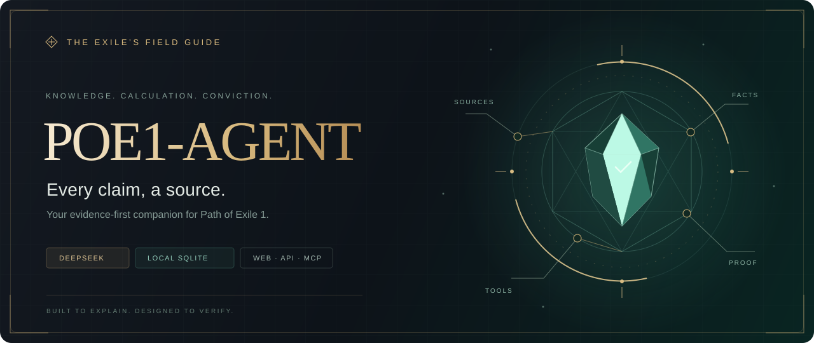
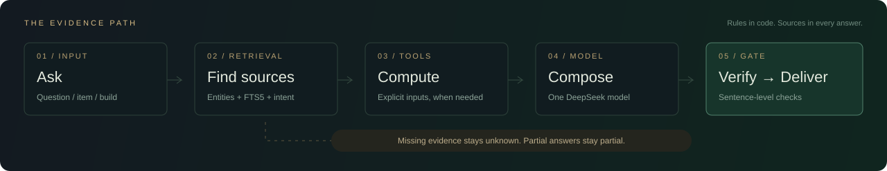

<div align="center">



# POE1-Agent

**你的《流放之路 1》证据工作台。**

查机制、看装备、拆 Build、算制作。让每一条结论，都有来处。

<p align="center">
<a href="https://github.com/wangyy2113/poe-agent/actions/workflows/ci.yml"></a>


</p>

[能力地图](#capabilities) · [快速启动](#quickstart) · [工作原理](#how-it-works) · [接入方式](#integrations) · [完整文档](docs/README.md)

</div>

---

## 不止回答，还要给出依据

POE1 的一个词缀、一处取整、一次伤害转化，都可能改变整套结论。POE1-Agent 将公开资料、本地检索和确定性计算工具串在一起：**事实附来源，计算附输入与推导，缺据就说明缺什么。**

用浏览器直接聊，粘贴装备或 PoB，也可以让已有客户端通过 HTTP / MCP 调用同一套工具。知识库和会话保存在本机 SQLite；需要模型的生成与截图转录，通过你配置的网关调用 **`deepseek-v4-1-flash-1017`**。

> **无据不答，是执行路径。** 检索不足时不进入生成；模型输出按句经过引用与数值校验后才下发。复合问题可以回答有据的部分，同时列出缺失信息。

<a id="capabilities"></a>

## ◈ 从一件装备，到一套决策

<table>
<tr>
<td width="50%" valign="top">
<h3>01 · 知识检索</h3>
中文名、英文名、别名一起查。装备、词缀、宝石、地图、天赋与官方公告，沿着引用回到原始资料。
</td>
<td width="50%" valign="top">
<h3>02 · 装备与 Build</h3>
粘贴游戏复制文本、PoB 码或分享链接，查看词缀与 <b>PoB Build 体检</b>。截图先转录，确认后再分析。
</td>
</tr>
<tr>
<td valign="top">
<h3>03 · 制作推演</h3>
查词缀名额与组合，核对通货、精华、收获、古灵、隐匿和化石的条件与后状态；独立尝试预算明确列出适用假设。
</td>
<td valign="top">
<h3>04 · 伤害与生存</h3>
用显式输入计算抗性、命中、DPS、持续伤害与 Boss 命中风险。计算器负责数值，模型负责解释。
</td>
</tr>
<tr>
<td valign="top">
<h3>05 · 经济与规划</h3>
查询价格快照、趋势、材料成本与可比挂单；检查双边价差，探索 Atlas 候选节点和图路线。
</td>
<td valign="top">
<h3>06 · 来源与版本</h3>
对照跨来源差异、唯一装备历史变体和版本公告；同步记录数据 diff，备份支持校验与离线恢复。
</td>
</tr>
</table>

**从这些问题开始：**

```text
「猎首（Headhunter）有哪些词缀？」
「戒指上『+最大生命』的 T1 是多少？」
「生命 5000、火抗 75%，一发能承受多少火焰伤害？」
「这份 PoB 有哪些已知缺口？」 → 粘贴 PoB，确认导入
```

功能会受当前已采集资料与输入完整度约束。[查看逐项能力与数据覆盖 →](docs/capabilities.md)

<a id="quickstart"></a>

## ⚡ 启动你的工作台

需要 **Python 3.10+，推荐 3.12**。支持 macOS、Linux 与 Windows；运行 Web 无需 Node 或独立数据库服务。

### 1. 克隆并初始化

```bash
git clone https://github.com/wangyy2113/poe-agent.git
cd poe-agent
python scripts/setup.py
```

初始化会创建 `.venv`、安装锁定依赖、准备数据目录，并在 `.env` 不存在时从模板生成它。

### 2. 配置模型与访问凭证

编辑本机 `.env`。下面均为占位值，需要替换；模型 ID 保持不变。

```dotenv
LLM_BASE_URL=https://your-llm-gateway.example.com
LLM_API_KEY=your-model-api-key
LLM_MODEL=deepseek-v4-1-flash-1017
ADMIN_TOKEN=your-separate-admin-token
# 如需访问控制，设置独立的普通用户 Key：
# API_KEYS=your-user-api-key
```

网关需提供该模型的 OpenAI 兼容 Chat Completions 接口。文本、工具调用、截图共用一套模型与凭证；远程 Embedding / ReRank 已停用。真实地址和密钥只保存在本机，勿提交到 Git。

### 3. 建库并启动

<details open>
<summary><b>macOS / Linux</b></summary>

```bash
.venv/bin/python -m kb.pipeline --category all
.venv/bin/python main.py
```

</details>

<details>
<summary><b>Windows · PowerShell</b></summary>

```powershell
.venv\Scripts\python.exe -m kb.pipeline --category all
.venv\Scripts\python.exe main.py
```

</details>

首次建库会联网抓取公开资料，受来源限速影响，耗时可能较长。`all` 是 POEDB 基础采集集合；PoB 常量与其他扩展数据需[按需导入](docs/setup.md#pob-数据导入)。**仓库不附带已填充的知识库**，空库或缺少资料时会明确返回缺据。

| 打开 | 地址 |
| :--- | :--- |
| **聊天工作台** | [localhost:8787/poe_agent/](http://127.0.0.1:8787/poe_agent/) |
| **交互式 API 文档** | [localhost:8787/poe_agent/docs](http://127.0.0.1:8787/poe_agent/docs) |
| **健康状态** | [localhost:8787/poe_agent/healthz](http://127.0.0.1:8787/poe_agent/healthz) |

默认只监听 `127.0.0.1`，路由前缀由 `config.yaml` 的 `server.base_path` 控制。配置 `API_KEYS` 后，在网页的「API 密钥」中填入普通用户 Key；管理操作使用独立 `ADMIN_TOKEN`。对外部署请配置访问控制与 TLS。

[完整安装指南，包括模型迁移、PoB 数据导入和客户端配置 →](docs/setup.md)

<a id="how-it-works"></a>

## ⌘ 一条答案，如何走到你面前



| 层 | 在做什么 |
| :--- | :--- |
| **检索** | 实体精确匹配、FTS5 / BM25 和词缀意图召回，通过 RRF 与来源优先级融合。 |
| **工具** | 解析输入、读取事实、执行公式或状态转移；数据缺失时保留 `unknown`。 |
| **生成** | 一个固定 DeepSeek 模型组织答案，按需继续调用工具；确定性路径可直接返回。 |
| **校验** | 检查事实与引用的绑定、数值出处，再按句输出。失败或截断不保存为完整会话答案。 |

**轻量部署，完整证据链。** 一个 Python 进程、一个 SQLite 文件、原生静态网页。无需容器、向量数据库或前端构建；模型请求和实时数据查询仍需网络。

<a id="integrations"></a>

## ↗ 同一套能力，三种入口

### Web · 打开就用

聊天、装备粘贴、PoB 导入、截图确认，以及制作、经济、Boss 风险等专题工作台。会话与显式长期记忆按调用方隔离；长期记忆不会成为游戏事实证据。

### HTTP · 接到你的工具里

```bash
curl http://127.0.0.1:8787/poe_agent/chat \
  -H 'Content-Type: application/json' \
  -d '{"message":"猎首（Headhunter）有哪些词缀？"}'
```

设置了 `API_KEYS` 时，添加 `Authorization: Bearer <普通用户 Key>` 请求头。

| 入口 | 用途 |
| :--- | :--- |
| `POST /chat` · `POST /chat/stream` | 问答与按句校验的 SSE |
| `POST /v1/chat/completions` | OpenAI 格式的文本请求与流式响应；仍经过检索和出口校验 |
| `POST /search` | 只检索，返回引用候选及充分依据判定 |
| `POST /item` · `POST /build` | 装备解析与 Build 报告 |

上表路径统一加 `/poe_agent` 前缀。[更多接口、完整请求与返回示例 →](docs/api-recipes.md)

### MCP · 把证据工具交给你的客户端

```bash
.venv/bin/python mcp_server.py --tools kb_coverage,entity_lookup,kb_search
```

这是 stdio 工具服务器，无需先启动 Web。省略 `--tools` 可暴露 Knowledge Agent 的全部只读工具；配置客户端时使用解释器和脚本的绝对路径。工具结果保留来源、边界与未知项。

[客户端配置示例 →](docs/setup.md#作为-mcp-工具服务器使用)

## ◇ 知道边界，才值得信任

- **只覆盖 POE1。** POE2 问题走边界声明，避免把两款游戏的同名机制混在一起。
- **PoB 快照是输入，完整伤害引擎不是本项目的替代目标。** 独立计算器只使用明确给出的参数。
- **条件状态不是完整制作路线，基础权重不是单次成功率。** 概率和预算模型会列出自己的适用条件。
- **挂单不是成交，模拟不是通关保证。** 缺少来源、时效、样本或关键输入时，结果保持未知。

[查看全部边界、已知缺口与来源优先级 →](docs/limitations.md)

## 🛠 为验证留好入口

```bash
# 离线单元测试
.venv/bin/python -m unittest discover -s tests -t .

# 全新 SQLite、备份恢复与接口装配冒烟
.venv/bin/python scripts/ci_smoke.py

# 使用本机知识库回放已录制的黄金问答
.venv/bin/python scripts/eval_run.py --gate
```

CI 覆盖 Linux / Windows、Python 3.10 / 3.12，并单独验证跨平台数据库迁移。测试与回放记录见 [Actions](https://github.com/wangyy2113/poe-agent/actions)；[开发文档](docs/development.md)提供目录结构、评测指标与更多验证命令。

贡献时，请把来源、输入、预期输出和验证方式一起带上。涉及事实与数值的改动，应同时检查无据内容漏出和错误拒答。

---

<div align="center">

**Knowledge has a source. Power has a cost.**

[安装与接入](docs/setup.md) · [能力清单](docs/capabilities.md) · [API 示例](docs/api-recipes.md) · [数据与运维](docs/operations.md) · [开发与评测](docs/development.md)

<sub>游戏数据与相关商标归 Grinding Gear Games 及各自权利方所有。本项目为非官方工具，与 GGG 无隶属关系。感谢 POEDB、Path of Building Community、PoE Wiki、Craft of Exile、poe.watch 与官方数据源。</sub>

</div>
